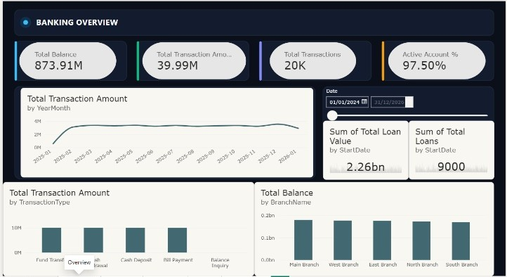
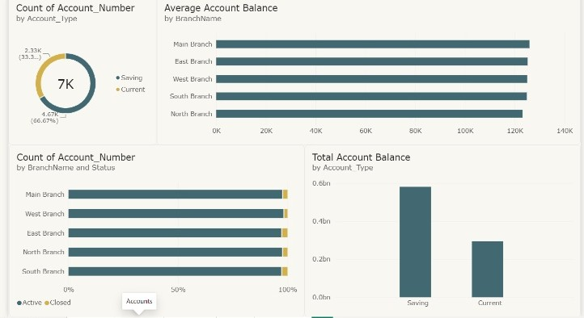
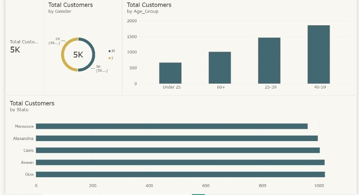
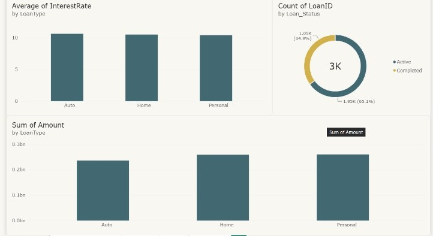
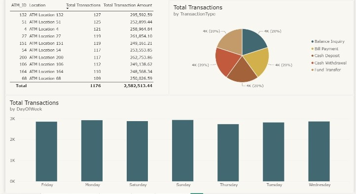

# Final Project — Bank Analytics (SQL + Power BI)

End-to-end analysis of a retail bank database: data cleaning in Excel, 15 analytical T-SQL queries, and a 5-page Power BI dashboard, wrapped up in a presentation with business insights and recommendations.

## Dataset

11 tables, ~5,000 customers, 7,000 accounts, 3,000 loans, and 20,000 ATM transactions across 5 branches.

`Branch` · `Department` · `Employee` · `Customer` · `Customer_Phones` · `ATM` · `Account` · `Card` · `Loan` · `Transactions` · `transactions_ATM_Account`

## Structure

```
Final-Project/
├── Excel/          # BankDB_Cleaned.xlsx — cleaned dataset (one sheet per table)
├── SQL/            # Bank_Analysis_Queries.sql — 15 documented queries
├── Presentation/   # Bank_Analytics.pptx — full report with screenshots
├── images/         # Dashboard screenshots
└── *.pbix          # Power BI dashboard files
```

## SQL — 15 queries

Each query is written with its business question and insight in the file header.

| Topic | Queries |
|---|---|
| Filtering & sorting | Q1 high-value active accounts · Q2 recent loans |
| Aggregation (`GROUP BY`, `HAVING`) | Q3 branch account summary · Q4 high-volume branches |
| Joins | Q5 customer–account–branch detail · Q6 customers without loans (anti-join) |
| CTEs | Q7 branch loan performance |
| Window functions | Q8 MoM transaction trend (`LAG`) · Q9 customer rank by state (`RANK`) · Q10 running balance (`SUM OVER`) · Q11 loans vs type average (`AVG OVER`) · Q13 salary vs branch average · Q15 top 3 customers per branch (`ROW_NUMBER`) |
| Other | Q12 card portfolio breakdown · Q14 most active ATMs |

**Tech:** T-SQL (SQL Server)

## Power BI Dashboard

Five pages: Overview, Accounts, Customers, Loans, Transactions.



| Accounts | Customers |
|---|---|
|  |  |

| Loans | Transactions |
|---|---|
|  |  |

## Key Insights

- **Deposits are evenly spread:** 873.91M total balance, with each of the 5 branches holding between ~170M and ~180M. Savings accounts make up two-thirds of accounts and ~0.58bn of balances.
- **Healthy operations:** 97.5% of accounts are active and only ~2.5% of cards are blocked.
- **Loan portfolio:** 3,000 loans worth 754.3M, 65.1% still active. Personal (260M) and Home (258.8M) loans lead, at a uniform ~10.5% interest rate.
- **Stable transaction flow:** 20K transactions worth ~40M, split evenly across five transaction types, with ~3.3M per month throughout 2025.

## Recommendations

- Run a **cross-selling campaign** on the customers with active accounts but no loans (Q6).
- Prioritize **cash replenishment and maintenance** for the busiest ATMs (132, 200, 27, 51).
- Assign **relationship managers** to top depositors identified in Q1, Q5, and Q15.
- Offer competitive returns on **savings accounts** to retain the largest share of deposits.
- Dashboard upgrades: drill-through by branch, a What-If parameter for interest rates, and conditional formatting on high-withdrawal ATMs.

## Files

| File | Description |
|---|---|
| `Final-Project.pbix` | Power BI dashboard |
| `Final-Project-v2.pbix` | Later revision of the dashboard |
| `SQL/Bank_Analysis_Queries.sql` | All 15 queries |
| `Excel/BankDB_Cleaned.xlsx` | Cleaned data |
| `Presentation/Bank_Analytics.pptx` | Presentation (Arabic) |
